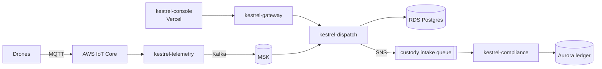

# kestrel-platform

Infrastructure for the Kestrel medical drone delivery platform: AWS (EKS, RDS, Aurora, MSK, SNS/SQS, IoT-facing DNS) and Cloudflare, managed with Terraform. Kubernetes workloads are deployed from this repo with Helm and Argo CD (see `deploy/`).

## System overview



| Repo | Role |
| --- | --- |
| kestrel-console | Operator web app (Next.js on Vercel) |
| kestrel-gateway | Public API edge (Go) |
| kestrel-dispatch | Mission planning and scheduling (Go) |
| kestrel-telemetry | Drone telemetry ingest (Rust) |
| kestrel-compliance | Chain-of-custody ledger (Python) |
| kestrel-contracts | Shared schemas |
| kestrel-platform | This repo |

## Layout

- `terraform/envs/prod` - the single production root module
- `terraform/modules/*` - network, eks, rds, aurora, msk, messaging, dns, iam, observability, ecr_cache, waf, backup
- `docker-compose.yml` - local stack for gateway + dispatch

## Local development

```sh
docker compose up -d
```

Starts Postgres, Redpanda, LocalStack (SNS/SQS) and the latest gateway and dispatch images.

## Terraform

```sh
cd terraform/envs/prod
cp terraform.tfvars.example terraform.tfvars
terraform init && terraform plan
```

PRs run plan, tflint and checkov; merges to `main` apply with the `kestrel-github-terraform` role via GitHub OIDC. A nightly workflow fails on drift.

Note: `edge.kestrel-air.net` is created by external-dns from the gateway Ingress, not by Terraform.
